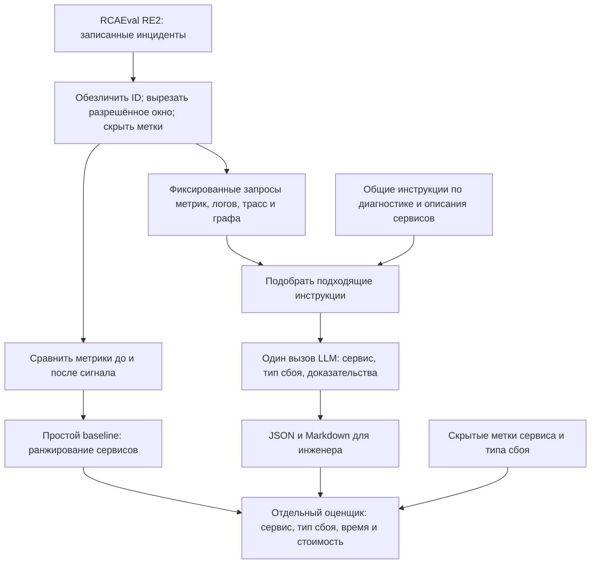
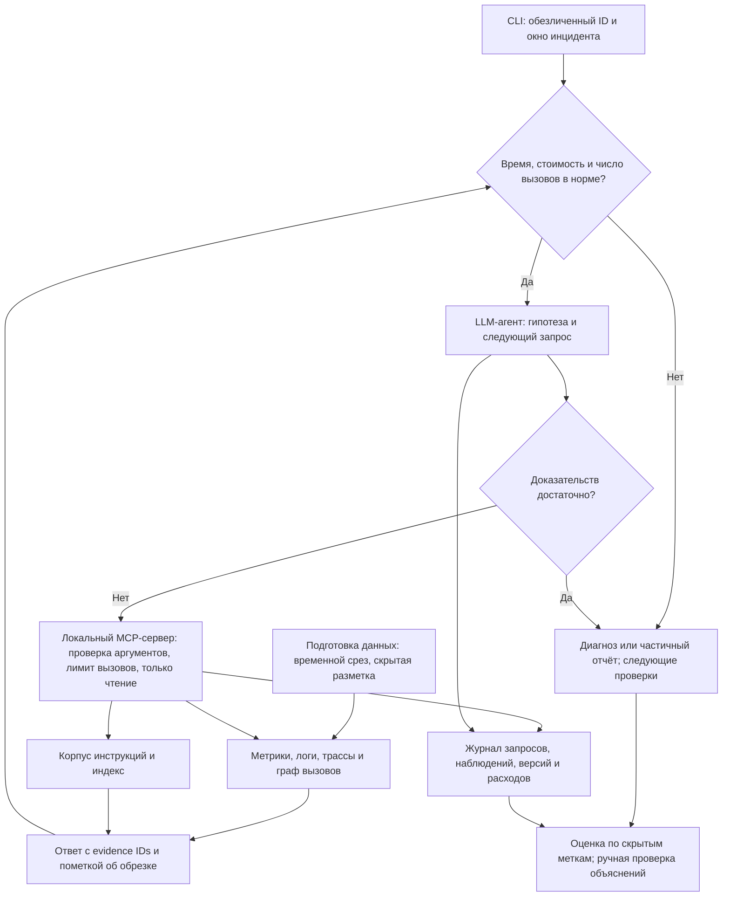

# Дизайн ML-системы: агент диагностики инцидентов в микросервисном приложении

## 1. Цели и предпосылки

### 1.1. Зачем мы это делаем

**Пользователь: дежурный SRE-инженер.** Когда приходит сигнал о сбое, инженеру нужно сопоставить метрики, логи и трассы и понять, где источник проблемы. Сложность в том, что сбой одного сервиса тянет за собой ошибки в соседних, и самый заметный симптом часто указывает не туда.

Агент берёт эту рутину на себя. Он изучает телеметрию, называет наиболее вероятный проблемный сервис и тип сбоя, показывает, на каких наблюдениях основан вывод, и подсказывает, что проверить дальше. В первой версии работаем с типичным микросервисным приложением: интернет-магазином из нескольких взаимодействующих сервисов.

**Бизнес-цель: быстрее получать обоснованную гипотезу о причине сбоя.** LLM хорошо справляется с разнородными данными: числами, текстом логов, структурой вызовов. Следующий запрос агент выбирает по уже увиденному, как опытный инженер. Пользу сравниваем с ручным разбором и с простой фиксированной последовательностью запросов. Влияние на простой и MTTR будем измерять отдельно.

### 1.2. Требования и ограничения

Сценарий простой: инженер выбирает инцидент и временное окно, агент собирает данные и выдаёт отчёт, инженер проверяет выводы и решает, что делать.

| Что нужно | Как это выглядит |
| --- | --- |
| Найти источник сбоя | Вероятный сервис и тип сбоя или честный отказ, если данных не хватает. |
| Обосновать вывод | Ссылки на конкретные метрики, записи логов или span с временем наблюдения. |
| Подсказать следующий шаг | До трёх проверок, каждая с пояснением, какую гипотезу она уточняет. |
| Оставить решение за человеком | Агент только читает данные; любые исправления делает инженер. |
| Уложиться в ресурсы | Не больше 12 вызовов инструментов, 120 секунд и $0,10 на один разбор. |
| Получать воспроизводимый результат | Зафиксированные версии модели, prompt, данных и инструментов; полный журнал вызовов. |

На вход агент получает обезличенный ID инцидента, время сигнала и окно наблюдений. На выходе JSON для автоматической оценки и Markdown для инженера: основная гипотеза, до двух альтернатив, доказательства, рекомендации и ограничения вывода. Числовую «уверенность» не показываем, пока не умеем её калибровать.

Общий бюджет на API: $50. Сюда входят подготовка данных, поиск, вызовы LLM и повторы. Перед каждым запросом стоимость оцениваем по тарифу и лимиту токенов, после сверяем с фактическим расходом. Если тариф неизвестен, запуск не начинается; если закончились деньги или время, агент возвращает частичный отчёт. Насколько реалистичны эти лимиты, проверим на пилоте.

### 1.3. Что делаем в первой итерации

**Входит:** офлайн-диагностика микросервисного приложения, шесть типов одиночных сбоев, один агент на готовой LLM через API, локальный MCP-сервер, поиск по инструкциям, CLI, отчёты и стенд для оценки качества.

**Не входит:** автоматическое обнаружение инцидентов, работа с живым Kubernetes, интеграция с production, автоисправление, поиск конкретной строки кода с ошибкой, несколько одновременных причин, дообучение модели, самоэволюция агента, мультиагентность и веб-интерфейс. Историю релизов тоже не используем: нет уверенности, что она есть в данных.

Сейчас готовы дизайн и окружение разработки. Агент и оценка качества в работе. Подключение реальных источников, авторизация и масштабирование остаются следующими шагами.

### 1.4. Из чего исходим

- В наборе RCAEval есть метрики, логи, трассы и известная причина каждого сбоя. Насколько данные полны и согласованы, покажет EDA.
- Момент внедрения сбоя (`inject_time`) считаем моментом сигнала. Качество и задержку обнаружения не оцениваем.
- Каждый случай содержит ровно одну причину. Решение принимается по инциденту целиком.
- Граф вызовов строим по трассам, поэтому он может быть неполным.
- Инструкции по диагностике пишутся отдельно и не содержат ответов на тестовые случаи. Агент и база знаний замораживаются до начала оценки.

## 2. Методология

### 2.1. Постановка задачи

По телеметрии нужно определить сервис и тип сбоя, объяснить вывод и предложить следующие проверки, уложившись в ограниченный бюджет. Формально это классификация причины с возможностью отказа плюс последовательный выбор диагностических запросов.

Целевые метки: `root_cause_service` и `fault`. Типы сбоев: `cpu`, `mem`, `disk`, `delay`, `loss`, `socket`. CLI принимает ID, окно и конфигурацию; JSON содержит статус, гипотезы, `evidence_ids`, рекомендации и расход ресурсов.

| MCP-инструмент | Что делает |
| --- | --- |
| `query_metrics` | Показывает, как менялись метрики сервиса до и после сигнала. |
| `search_logs` | Ищет сообщения по сервису, времени и тексту. |
| `get_traces` | Показывает длительности, статусы и связи span. |
| `get_service_graph` | Строит граф вызовов между сервисами в выбранном окне. |
| `search_runbooks` | Ищет инструкции по симптому или гипотезе. |

MCP-сервер проверяет ID и границы окна, ограничивает размер ответа (и помечает, если что-то обрезано) и сохраняет идентификаторы наблюдений. Произвольные пути, SQL, код и команды ОС агенту недоступны. Права ограничивает код, а не только prompt или аннотации MCP.

### 2.2. Схемы решения

#### Baseline

Самый простой ориентир ранжирует сервисы по тому, насколько сильно изменились их метрики. Основной baseline устроен иначе: он по фиксированному сценарию собирает телеметрию и инструкции и один раз вызывает LLM.

#### Агент (MVP)

Агент работает итеративно: выдвигает гипотезу, решает, какие данные её проверят, запрашивает их и уточняет вывод. У него та же LLM, те же источники, окно и лимит стоимости, что у baseline. Разница только в порядке запросов и числе вызовов LLM в пределах бюджета.

### 2.3. Этапы решения задачи

> Этап 1 опирается на проведённый EDA: [notebooks/01_rcaeval_eda.ipynb](../notebooks/01_rcaeval_eda.ipynb)

| Этап | Что делаем | Результат |
| --- | --- | --- |
| 1. Подготовка данных | Загрузка, EDA, разметка, окно, разбиение, маскирование | Проверенный набор, манифест разбиения, список проблем данных и решений по ним |
| 2. Подготовка моделей | Метрики, схема валидации, baseline, агент | Сравнение на валидации и замороженная конфигурация |
| 3. MCP-инструменты | Сводки телеметрии, лимиты, evidence IDs, защита | MCP-сервер с тестами |
| 4. База инструкций | Корпус runbook'ов и поиск по нему | Зафиксированная версия корпуса и проверка поиска |
| 5. Финальная оценка | Один прогон на тесте, ручная проверка объяснений | Отчёт с метриками, разбором ошибок и решением о пилоте |

Этапы идут не строго по порядку.

#### Этап 1. Подготовка данных

##### Откуда берутся данные

MVP пока готовим на открытых данных: берём набор [RCAEval](https://huggingface.co/datasets/phamquiluan/RCAEval), подмножество RE2 для интернет-магазина. Авторы набора развернули микросервисное приложение, подали на него синтетическую нагрузку и внедряли в один сервис сбой одного из шести типов: нагрузка на CPU, память, диск, сетевая задержка, потеря пакетов, исчерпание сокетов.

Набор статичный: новые инциденты в нём не появляются. Мы скачиваем его один раз скриптом `scripts/download_rcaeval.py`.

##### Что лежит в наборе

90 инцидентов: 5 сервисов со сбоями × 6 типов × 3 повтора, каждая пара «сервис × тип» встречается ровно три раза. На каждый инцидент:

- `metrics.parquet`: 69–77 рядов с шагом 1 с (CPU, память, диск, сокеты, нагрузка, ошибки, задержки p50 и p90);
- `logs.parquet`: 110–181 тыс. строк (время, контейнер, сообщение);
- `traces.parquet`: 200–413 тыс. span;
- `inject_time.txt`: время внедрения сбоя.

##### Проблемы данных

| Проблема | Что делаем |
| --- | --- |
| Пропуски в метриках: 71 инцидент, до 5,1% значений | Не заполняем, показываем число доступных точек |
| Две трети строк логов повторяются (медиана 66,7%) | Группируем строки в шаблоны со счётчиками |
| У 4,7–5,5% span статус неизвестен, в 60 инцидентах у части span не найден родитель | Неизвестный статус не считаем OK, неполноту графа помечаем |
| Трассы есть только у 7 сервисов из 10, логи `productcatalogservice` только в 4 инцидентах | «Нет записей» не значит «всё в порядке» |
| Один сервис называется `frontendservice` в трассах и `frontend` в метриках и логах | Словарь имён |

##### Что EDA говорит о сигнале

Выводы по данным:

- один показатель тип сбоя не определяет: CPU растёт при `cpu`, `disk` и `mem`, задержка почти при всех типах, различает только сочетание метрик;
- `delay` и `loss` по метрикам почти неразличимы, их придётся различать по логам и трассам;
- повторы одной пары сильно расходятся, поэтому жёсткие пороги не подойдут;
- логи реагируют слабо, а в трассах сбой виден у отдельных операций и у соседей источника, поэтому без графа вызовов причину легко спутать со следствием.

##### Разметка и разбиение

Метки (сервис и тип сбоя) берутся из метаданных, у каждого случая одна причина. Ответ записан в имени папки (`re2ob_checkoutservice_cpu_1`), поэтому агент видит только обезличенные ID и окно 5 минут до сигнала и 5 после. Метки видит только оценщик.

Делим случаи на 54/18/18 (development, validation, test) по группам: три повтора одной пары всегда попадают в одну часть, иначе тест покажет запоминание. В каждой части есть все сервисы и все типы, но в разных сочетаниях. Разбиение детерминированное (`random.Random(42)`).

##### Хватит ли данных

Для настройки prompt и инструментов хватает: веса мы не обучаем, а development покрывает все сервисы и типы. Для уверенного сравнения методов мало: в тесте 6 независимых групп, один ответ меняет точность на 5,6 п.п. Поэтому публикуем результаты по группам, а перенос проверяем на двух других приложениях из RE2 с теми же типами сбоев. Собственный стенд с внедрением сбоев рассматриваем для следующей итерации.

##### Результат этапа

Готовы скрипт загрузки, EDA-ноутбук и разбиение. Осталось сохранить разбиение в манифест, сделать обезличенные ID и правила маскирования.

#### Этап 2. Подготовка прогнозных моделей

Веса мы не обучаем. Модель здесь означает конфигурацию: LLM, её параметры, prompt, инструменты и правила остановки.

##### Метрики и функция потерь

| Метрика | Зачем |
| --- | --- |
| AC@1 по сервису (основная) | Инженер начинает проверку с первой гипотезы |
| AC@3 по сервису | В отчёте до трёх гипотез |
| Точность пары «сервис и тип сбоя» | От типа сбоя зависят следующие проверки |
| Доля отказов | Отказ лучше уверенной ошибки, но частые отказы делают агента бесполезным |
| Корректность ссылок на наблюдения | Обязательное условие: ссылка на несуществующие данные хуже её отсутствия |
| Обоснованность объяснения (вручную) | Верный сервис с ложным объяснением вводит инженера в заблуждение |
| Время, стоимость, число вызовов | Ограничения из 1.2 |

Ошибки, тайм-ауты и отказы в AC@1 считаем неуспехом.

Функции потерь нет, раз нет обучения. Конфигурацию выбираем на validation: отбрасываем варианты, которые нарушают лимиты или ссылаются на несуществующие данные, из оставшихся берём лучший по AC@1.

##### Схема валидации

- Групповой hold-out 54/18/18 из этапа 1. k-fold для LLM не используем: каждый прогон стоит денег, а настройка prompt по всем фолдам подгоняет его под весь набор.
- Development служит для настройки, validation для выбора из 3–5 финалистов, test запускаем один раз после заморозки.
- Лимиты из 1.2 (12 вызовов, 120 с, $0,10) проверяем в каждом прогоне, превышение считается неуспехом.
- Каждый случай прогоняем 3 раза, потому что ответы LLM меняются; в отчёте даём среднее и разброс. Методы сравниваем на одних и тех же случаях, окнах, LLM и лимитах.

##### Baselines

- **B0, частотный:** самый частый сервис и тип сбоя в development. Нижняя граница.
- **B1, ранжирование по метрикам без LLM:** для каждого ряда считаем сдвиг медианы после сигнала относительно разброса до него, выбираем сервис с наибольшим сдвигом, тип сбоя определяем по виду метрики. По EDA `loss` от `delay` он не отличит, поэтому это ориентир для поиска сервиса.
- **B2, фиксированный LLM-пайплайн:** пять лучших кандидатов из B1, фиксированный набор запросов метрик, логов, трасс и графа, поиск инструкций и один вызов LLM. С ним сравниваем агента.

Агент получает те же инструменты и лимиты, но сам выбирает, что запросить и когда остановиться.

##### Развитие решения

- Выбор LLM: 2–3 модели через API, сравниваем на development по AC@1 и стоимости.
- Признаки внутри инструментов: шаблоны логов, сочетания метрик, сравнение задержки сервиса с задержкой его зависимостей по графу.
- Подсказки по типам сбоев в prompt пишем по итогам EDA. Число шагов и порог отказа подбираем небольшой сеткой на development.

##### Интерпретация

Каждый вывод агента ссылается на конкретные наблюдения, ссылки проверяются автоматически. Кроме того, смотрим матрицу ошибок по типам сбоев (по EDA ждём путаницы `cpu`/`mem`/`disk` и `delay`/`loss`), абляции без логов, трасс и инструкций и траектории запросов.

##### Риски этапа

| Риск | Как снижаем |
| --- | --- |
| Prompt подогнан под development | Validation только для выбора финалистов, test один раз |
| Ответы LLM нестабильны | Temperature 0, 3 прогона, разброс в отчёте |
| Маленький тест | Результаты по группам, проверка переноса на другие приложения |
| Агент выигрывает числом вызовов | Одинаковые лимиты для B2 и агента |

##### Результат этапа

Метрики B0, B1, B2 и агента на validation и замороженная конфигурация: model ID, параметры, prompt, версии инструментов и корпуса.

#### Этап 3. MCP-инструменты

Инструменты отдают сводки вместо сырых данных: сдвиги метрик с числом точек, шаблоны логов со счётчиками, сдвиги p95 по операциям, рёбра графа. Пропуски, неполное окно и неполный граф помечаются, у каждого наблюдения есть стабильный evidence ID. Доступ только на чтение, аргументы проверяются по схеме, чувствительные поля маскируются.

**Результат:** MCP-сервер с тестами по сценариям из раздела 4.

#### Этап 4. База инструкций

Готовых runbook'ов в наборе нет, поэтому корпус пишем сами: по документу на каждый тип сбоя, описания сервисов и общий порядок диагностики. ID случаев и ответов в корпусе нет. Поиск начинаем с BM25; для случаев development нужная инструкция должна попадать в top-3.

**Результат:** зафиксированная версия корпуса и индекс.

#### Этап 5. Финальная оценка

После заморозки запускаем B0, B1, B2 и агента на 18 тестовых случаях, метки видит только отдельный оценщик. Объяснения проверяем вручную, не зная, какой метод их написал. Цель: AC@1 агента минимум на 10 п.п. выше B2, все лимиты соблюдены, ссылок на несуществующие данные нет. Тест маленький, поэтому это ориентир, а не строгий критерий.

**Результат:** отчёт с метриками и разбором ошибок и решение, идём ли в пилот с агентом или с B2.

## 3. Подготовка пилота

После офлайн-оценки сравниваем на новых случаях ручной разбор с разбором по отчёту агента. Один инженер не разбирает один и тот же случай в обоих режимах; порядок режимов чередуется, правильные ответы скрыты. Состав участников пока не согласован.

**Бизнес-гипотеза:** медианное время до верной гипотезы сокращается хотя бы на 20% без потери точности. Небольшой пилот не докажет снижение MTTR в production. Если агент окажется не лучше фиксированного baseline, выбираем более простое решение.

Parquet-файлы обрабатываем локально на CPU, LLM вызываем через API. Требования к памяти и скорость замерим на первых прогонах. Бюджет $50 распределён так: $10 на проверку данных и модели, $20 на разработку и валидацию, $15 на финальную оценку, $5 в запас на технические повторы. Хватит ли бюджета, проверяем до запуска теста.

Платные ответы кешируются по ключу из модели, точного входа, параметров и версий. Ответы из кеша не считаются новыми прогонами и не используются для замера задержки API. Трассы запусков сохраняются в `runs/`, секреты в Git не попадают.

## 4. Риски

| Риск | Что делаем |
| --- | --- |
| Утечка меток и подгонка под тест | Обезличенные ID, групповое разбиение, заморозка prompt и корпуса. |
| Неполные данные и ложные объяснения | EDA, пометки о пропусках, отказ при нехватке данных, ручная проверка. |
| Prompt injection через логи или документы | Внешний текст считается данными, а не инструкциями; права ограничены кодом MCP-сервера. |
| Зацикливание и перерасход | Общие счётчики с учётом повторов, остановка с частичным отчётом. |
| Изменения модели или окружения | Фиксация версий; перенос на другую систему оцениваем отдельно. |
| Отличия от production и конфиденциальность | Результаты на контролируемых сбоях не гарантируют перенос; работа с реальными логами требует отдельного согласования. |

При реализации обязательно проверяем: обычный инцидент, неполную телеметрию, неверные ID и границы окна, ошибки инструментов и API, исчерпание лимитов и инструкции, спрятанные в логах. Ни в одном сценарии агент не должен получить доступ к разметке.

## 5. Источники

- [RCAEval: данные и метаданные](https://huggingface.co/datasets/phamquiluan/RCAEval).
- [RCAEval: репозиторий авторов](https://github.com/phamquiluan/RCAEval).
- [MCP: границы доверия к аннотациям инструментов](https://blog.modelcontextprotocol.io/posts/2026-03-16-tool-annotations/).
