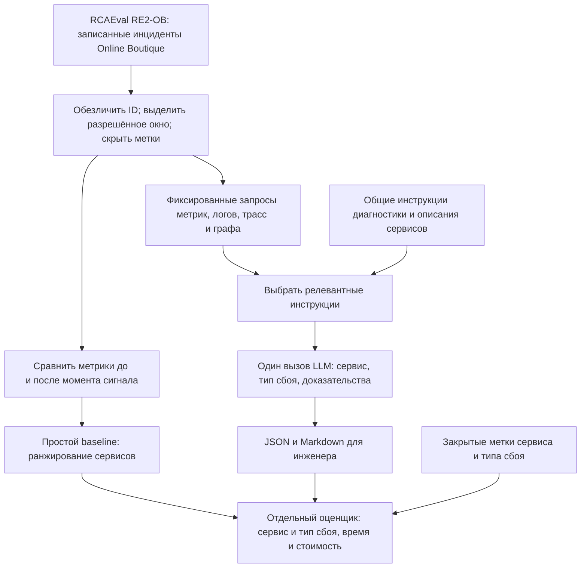
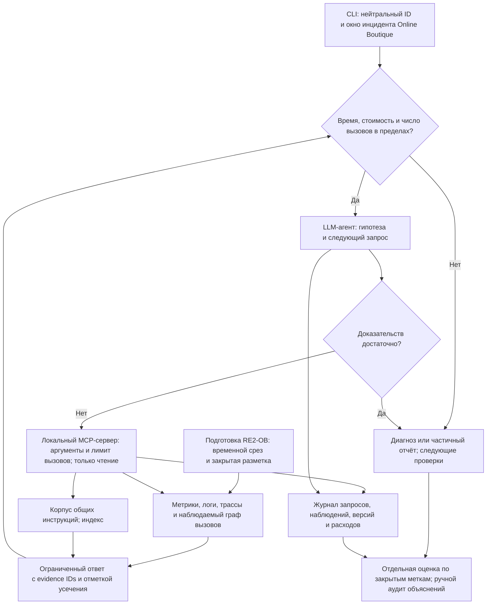

# Дизайн ML-системы: агент диагностики инцидентов микросервисного приложения

## 1. Цели и предпосылки

### 1.1. Зачем идём в разработку продукта

**Пользователь - дежурный SRE-инженер.** После сигнала о сбое он сопоставляет метрики, логи и трассы, чтобы найти источник проблемы. Ошибки зависимых сервисов усложняют поиск: заметный симптом не всегда указывает на причину.

Для первой итерации выбран микросервисный интернет-магазин Online Boutique. Агент должен определить вероятный проблемный сервис и тип сбоя, показать подтверждающие наблюдения и предложить следующие проверки.

**Бизнес-цель - сократить время до обоснованной диагностической гипотезы.** LLM интерпретирует неоднородные наблюдения, а агент выбирает следующий запрос по результатам предыдущих. Пользу сравниваем с ручной диагностикой и фиксированной последовательностью запросов. Сокращение простоя и MTTR требует отдельного измерения.

### 1.2. Бизнес-требования и ограничения

Инженер выбирает сохранённый инцидент и временное окно. Агент собирает данные и возвращает отчёт; инженер проверяет выводы и решает, что делать дальше.

| Требование | Результат |
| --- | --- |
| Локализовать сбой | Вероятный сервис и тип сбоя либо отказ при недостатке данных. |
| Обосновать вывод | Ссылки на метрики, записи логов или span с временем наблюдения. |
| Предложить следующий шаг | До трёх проверок с указанием уточняемой гипотезы. |
| Сохранить контроль инженера | Инструменты только читают данные; исправления выполняет человек. |
| Ограничить ресурсы | Не более 12 вызовов инструментов, 120 секунд и $0,10 на разбор. |
| Воспроизвести результат | Зафиксированные версии модели, prompt, данных и инструментов; журнал вызовов. |

Вход - нейтральный ID инцидента, время сигнала и окно наблюдений. Выход - JSON для оценки и Markdown для инженера: основная гипотеза, до двух альтернатив, доказательства, рекомендации и ограничения. Числовую уверенность без калибровки не выдаём.

Общий бюджет API - $50. В лимиты входят подготовка данных, поиск, LLM-вызовы и повторы. Стоимость проверяется перед запросом по тарифу и лимиту токенов, затем уточняется по фактическому расходу. При неизвестном тарифе запуск не начинается; при исчерпании бюджета или времени возвращается частичный отчёт. Выполнимость ограничений проверяется пилотом.

### 1.3. Что входит в скоуп итерации

**В MVP входят:** офлайн-диагностика Online Boutique, шесть типов одиночного сбоя, один агент с готовой LLM через API, локальный MCP-сервер, поиск по инструкциям, CLI, отчёты и оценочный стенд.

**Не входят:** обнаружение инцидентов, живой Kubernetes, production-интеграция, автоматическое исправление, поиск дефектной строки кода, несколько одновременных причин, обучение весов, самоэволюция, несколько агентов и веб-интерфейс. История релизов не используется: её доступность в данных не подтверждена.

Сейчас подготовлены дизайн и окружение разработки; агент и оценка качества ещё не реализованы. Подключение реальных источников, авторизация и масштабирование остаются следующими этапами.

### 1.4. Предпосылки решения

- RCAEval содержит метрики, логи, трассы и известную внедрённую причину. Полнота и согласованность данных требуют EDA.
- `inject_time` используется как момент сигнала. Обнаружение и возможная задержка сигнала не оцениваются.
- Один случай соответствует одной внедрённой причине. Единица решения - целый инцидент.
- Граф трасс отражает наблюдавшиеся вызовы, но может быть неполным.
- Общие инструкции готовятся отдельно и не содержат ответов на тестовые инциденты. Агент и база знаний фиксируются перед оценкой.

## 2. Методология

### 2.1. Постановка задачи

Определить сервис и тип сбоя по телеметрии, объяснить вывод и выбрать следующие проверки при ограниченном бюджете. Формально это классификация причины с возможностью отказа и последовательный выбор диагностических запросов.

Целевые метки: `root_cause_service` и `fault`. Типы сбоя: `cpu`, `mem`, `disk`, `delay`, `loss`, `socket`. CLI принимает ID, окно и конфигурацию; JSON содержит статус, гипотезы, `evidence_ids`, рекомендации и расход ресурсов.

| MCP-инструмент | Назначение |
| --- | --- |
| `query_metrics` | Сводки и изменения показателей сервиса до и после сигнала. |
| `search_logs` | Поиск сообщений по сервису, времени и тексту. |
| `get_traces` | Просмотр длительностей, статусов и связей span. |
| `get_service_graph` | Наблюдаемые связи сервисов в выбранном окне. |
| `search_runbooks` | Поиск инструкций по симптому или гипотезе. |

MCP-сервер проверяет ID и временные границы, ограничивает объём ответа, отмечает усечение и сохраняет идентификаторы наблюдений. Произвольные пути, SQL, код и команды ОС недоступны. Полномочия ограничиваются кодом, а не только prompt или аннотациями MCP.

### 2.2. Блок-схемы решения

#### Baseline

Простой ориентир ранжирует сервисы по стандартизированному изменению метрик. Основной baseline фиксированно собирает телеметрию и инструкции, затем вызывает LLM один раз.

#### Агентный MVP

Агент уточняет гипотезы и выбирает запросы по промежуточным наблюдениям. Он использует ту же LLM, источники, окно и предел стоимости, что и baseline. Различаются порядок запросов и число LLM-вызовов внутри бюджета.

### 2.3. Данные и подготовка эксперимента

#### Источник

[RCAEval RE2-OB](https://huggingface.co/datasets/phamquiluan/RCAEval) содержит 90 контролируемых инцидентов: 5 сервисов с инъекциями, 6 типов сбоя, 3 повтора каждой пары. [Ревизия набора](https://huggingface.co/datasets/phamquiluan/RCAEval/tree/afeacb11bcc94dadfd1c8f483ee4377b2b8b614e) зафиксирована; состав проверен по метаданным, EDA содержимого не выполнен.

| Данные | Использование |
| --- | --- |
| `metrics.parquet`, `logs.parquet`, `traces.parquet` | Наблюдения агента после проверки времени, единиц и пропусков. |
| Индекс и исходное имя случая | Метки сервиса и типа сбоя, доступные только оценщику. |
| `inject_time.txt` | Подготовка одинаковых окон относительно сигнала. |
| Отдельный корпус инструкций | Поиск признаков сбоев и следующих проверок. |

Готовых runbook’ов в наборе нет. Корпус готовится по [описанию Online Boutique](https://github.com/GoogleCloudPlatform/microservices-demo) и общим инструкциям диагностики. Версия документов фиксируется, расхождения с приложением в данных отмечаются; граф вызовов берётся из трасс.

#### Окно и защита от утечек

Доступны пять минут до сигнала и пять после. Конец окна фиксирован для всех методов; запросы агента его не сдвигают. Неполные записи и пропуски отмечаются, заполнение значениями из будущего запрещено. Ожидание пяти минут телеметрии не входит в вычислительные 120 секунд.

Метки, исходные имена и пути скрываются, в том числе в ошибках инструментов. Служебные сообщения инжектора исключаются единым правилом, выбранным на данных разработки. Тестовые ответы не пополняют prompt или базу знаний.

#### Разбиение

Используем 54/18/18 случаев для разработки, валидации и теста. Все три повтора пары «сервис × тип сбоя» остаются вместе:

1. Отсортировать списки сервисов и типов; перемешать сначала сервисы, затем типы одним `random.Random(42)`.
2. Для типа `i` отдать группу сервиса `i % 5` в валидацию, `(i + 1) % 5` в тест, остальные три группы в разработку.
3. Сохранить манифест; проверить размеры, отсутствие пересечений и наличие всех пяти сервисов и шести типов в каждой части. Несоответствие состава останавливает подготовку.

Тест проверяет новые сочетания известных сервисов и типов. Данные разработки используются для инструментов, prompt и правил обработки, без обучения весов.

#### Этапы реализации

EDA и манифест → простое ранжирование → фиксированный LLM-baseline → агент и MCP → валидация → финальная оценка. На данных разработки выбираются доступная API-модель и тариф, измеряются расходы. До теста фиксируются model ID, параметры, prompt, корпус и правила обработки.

### 2.4. Оценка качества

| Метрика | Как оценивается |
| --- | --- |
| Top-1 сервиса | Доля случаев с верным сервисом на первом месте. |
| Точность пары | Доля случаев с верными сервисом и типом сбоя. |
| Корректность ссылок | Существование наблюдений в разрешённом окне и совпадение значений. |
| Обоснованность объяснения | Ручная оценка: подтверждено, не подтверждено или противоречит данным. |
| Ресурсы и надёжность | Токены, стоимость, число запросов, медиана и p95 времени, доли ошибок и отказов. |

Ошибки, тайм-ауты и частичные результаты входят в знаменатель точности как неуспех. Наличие ссылки не доказывает причинность: эталонных объяснений нет, поэтому смысл выводов и рекомендаций проверяется вручную.

Сравнение парное: одинаковые случаи, окна, LLM и ограничения. Все методы выбирают сервис из общего каталога приложения, не суженного до пяти сервисов с инъекциями. Дополнительный частотный baseline строится только по меткам разработки; остальные сервисы получают нулевую частоту.

**Цель офлайн-пилота:** Top-1 выше фиксированного LLM-baseline минимум на 10 процентных пунктов, лимиты соблюдены, несуществующих ссылок нет. Противоречивые рекомендации исправляются до пилота с инженером.

Это предварительный ориентир: в тесте 18 случаев, но лишь 6 независимых групп. Два дополнительных верных ответа дают 11,1 процентного пункта. Публикуются абсолютные числа и результаты по группам; повторы сценария и LLM-запуски не считаются независимыми инцидентами.

## 3. Подготовка пилота

После офлайн-оценки сравниваем ручной разбор с разбором по отчёту агента на новых случаях. Один инженер не решает один случай в обоих режимах; порядок чередуется, метки скрыты. Состав участников пока не согласован.

**Бизнес-гипотеза:** медианное время до корректной гипотезы сокращается минимум на 20% без снижения точности. Малый пилот не подтверждает сокращение MTTR в production. Если агент не лучше фиксированного baseline, предпочтение отдаётся простому решению.

Parquet и обрабатываются локально на CPU, LLM доступна через API. Требования к памяти и скорость измеряются первыми прогонами. Бюджет $50: $10 на проверку данных и модели, $20 на разработку и валидацию, $15 на финальную оценку, $5 на технические повторы. Достаточность бюджета проверяется до теста.

Платные ответы кешируются с учётом модели, точного входа, параметров и версий. Кешированные ответы не считаются новыми прогонами и не используются для оценки задержки API. Трассы сохраняются в `runs/`, секреты - вне Git.

## 4. Риски

| Риск | Мера |
| --- | --- |
| Утечка меток и подгонка под тест | Нейтральные ID, групповое разбиение, фиксация prompt и корпуса. |
| Неполные данные и ложное объяснение | EDA, отметки пропусков, отказ при нехватке данных, ручной аудит. |
| Prompt injection через логи или документы | Внешние тексты считаются данными; полномочия ограничены кодом MCP-сервера. |
| Циклы и перерасход | Общие счётчики с учётом повторов, остановка с частичным отчётом. |
| Изменение модели или среды | Фиксация версий; перенос на другую систему оценивается отдельно. |
| Отличия от production и конфиденциальность | Контролируемые сбои не подтверждают перенос; реальные логи требуют отдельного согласования обработки. |

При реализации проверяются обычный инцидент, неполная телеметрия, неверные ID и границы окна, ошибки инструментов/API, исчерпание лимитов и инструкции внутри логов. Доступ к разметке должен быть исключён во всех сценариях.

## 5. Источники

- [RCAEval: данные и метаданные](https://huggingface.co/datasets/phamquiluan/RCAEval).
- [RCAEval: авторский репозиторий](https://github.com/phamquiluan/RCAEval).
- [Online Boutique: описание приложения](https://github.com/GoogleCloudPlatform/microservices-demo).
- [MCP: границы доверия к аннотациям](https://blog.modelcontextprotocol.io/posts/2026-03-16-tool-annotations/).
