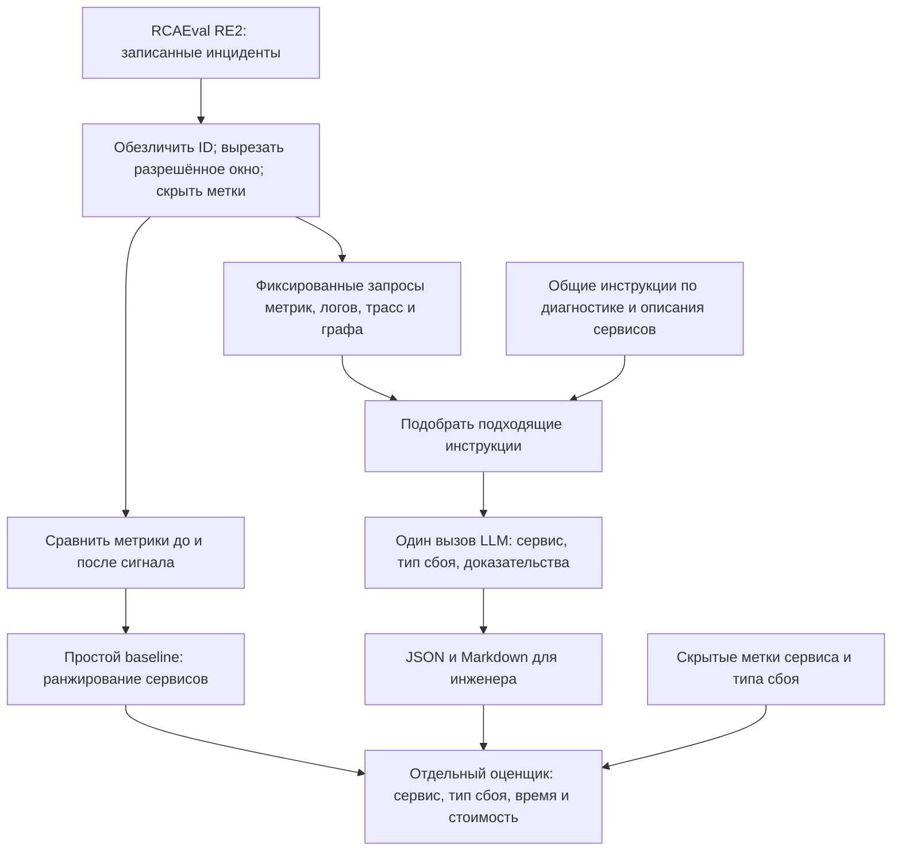
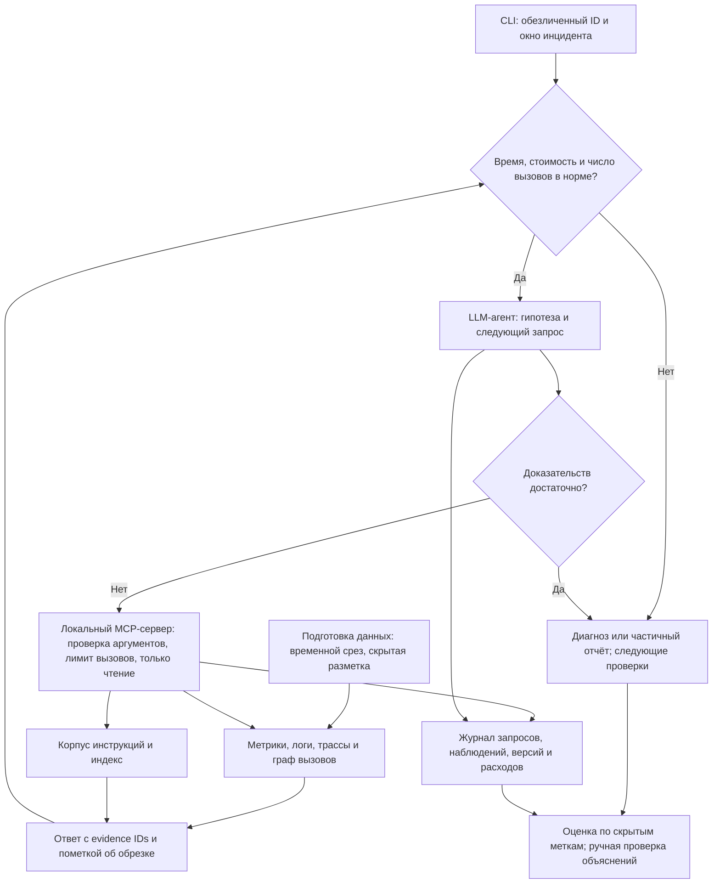

# Дизайн ML-системы: агент диагностики инцидентов в микросервисном приложении

## 1. Цели и предпосылки

### 1.1. Зачем мы это делаем

**Пользователь: дежурный SRE-инженер.** Когда приходит сигнал о сбое, инженеру нужно сопоставить метрики, логи и трассы и понять, где источник проблемы. Сложность в том, что сбой одного сервиса тянет за собой ошибки в соседних, и самый заметный симптом часто указывает не туда.

Агент берёт эту рутину на себя. Он изучает телеметрию, называет наиболее вероятный проблемный сервис и тип сбоя, показывает, на каких наблюдениях основан вывод, и подсказывает, что проверить дальше. В первой версии работаем с типичным микросервисным приложением: интернет-магазином из нескольких взаимодействующих сервисов.

**Бизнес-цель: быстрее получать обоснованную гипотезу о причине сбоя.** LLM хорошо справляется с разнородными данными: числами, текстом логов, структурой вызовов. Следующий запрос агент выбирает по уже увиденному, как опытный инженер. Пользу сравниваем с ручным разбором и с простой фиксированной последовательностью запросов. Влияние на простой и MTTR будем измерять отдельно.

### 1.2. Требования и ограничения

Сценарий простой: инженер выбирает инцидент и временное окно, агент собирает данные и выдаёт отчёт, инженер проверяет выводы и решает, что делать.

| Что нужно | Как это выглядит |
| --- | --- |
| Найти источник сбоя | Вероятный сервис и тип сбоя или честный отказ, если данных не хватает. |
| Обосновать вывод | Ссылки на конкретные метрики, записи логов или span с временем наблюдения. |
| Подсказать следующий шаг | До трёх проверок, каждая с пояснением, какую гипотезу она уточняет. |
| Оставить решение за человеком | Агент только читает данные; любые исправления делает инженер. |
| Уложиться в ресурсы | Не больше 12 вызовов инструментов, 120 секунд и $0,10 на один разбор. |
| Получать воспроизводимый результат | Зафиксированные версии модели, prompt, данных и инструментов; полный журнал вызовов. |

На вход агент получает обезличенный ID инцидента, время сигнала и окно наблюдений. На выходе JSON для автоматической оценки и Markdown для инженера: основная гипотеза, до двух альтернатив, доказательства, рекомендации и ограничения вывода. Числовую «уверенность» не показываем, пока не умеем её калибровать.

Общий бюджет на API: $50. Сюда входят подготовка данных, поиск, вызовы LLM и повторы. Перед каждым запросом стоимость оцениваем по тарифу и лимиту токенов, после сверяем с фактическим расходом. Если тариф неизвестен, запуск не начинается; если закончились деньги или время, агент возвращает частичный отчёт. Насколько реалистичны эти лимиты, проверим на пилоте.

### 1.3. Что делаем в первой итерации

**Входит:** офлайн-диагностика микросервисного приложения, шесть типов одиночных сбоев, один агент на готовой LLM через API, локальный MCP-сервер, поиск по инструкциям, CLI, отчёты и стенд для оценки качества.

**Не входит:** автоматическое обнаружение инцидентов, работа с живым Kubernetes, интеграция с production, автоисправление, поиск конкретной строки кода с ошибкой, несколько одновременных причин, дообучение модели, самоэволюция агента, мультиагентность и веб-интерфейс. Историю релизов тоже не используем: нет уверенности, что она есть в данных.

Сейчас готовы дизайн и окружение разработки. Агент и оценка качества в работе. Подключение реальных источников, авторизация и масштабирование остаются следующими шагами.

### 1.4. Из чего исходим

- В наборе RCAEval есть метрики, логи, трассы и известная причина каждого сбоя. Насколько данные полны и согласованы, покажет EDA.
- Момент внедрения сбоя (`inject_time`) считаем моментом сигнала. Качество и задержку обнаружения не оцениваем.
- Каждый случай содержит ровно одну причину. Решение принимается по инциденту целиком.
- Граф вызовов строим по трассам, поэтому он может быть неполным.
- Инструкции по диагностике пишутся отдельно и не содержат ответов на тестовые случаи. Агент и база знаний замораживаются до начала оценки.

## 2. Методология

### 2.1. Постановка задачи

По телеметрии нужно определить сервис и тип сбоя, объяснить вывод и предложить следующие проверки, уложившись в ограниченный бюджет. Формально это классификация причины с возможностью отказа плюс последовательный выбор диагностических запросов.

Целевые метки: `root_cause_service` и `fault`. Типы сбоев: `cpu`, `mem`, `disk`, `delay`, `loss`, `socket`. CLI принимает ID, окно и конфигурацию; JSON содержит статус, гипотезы, `evidence_ids`, рекомендации и расход ресурсов.

| MCP-инструмент | Что делает |
| --- | --- |
| `query_metrics` | Показывает, как менялись метрики сервиса до и после сигнала. |
| `search_logs` | Ищет сообщения по сервису, времени и тексту. |
| `get_traces` | Показывает длительности, статусы и связи span. |
| `get_service_graph` | Строит граф вызовов между сервисами в выбранном окне. |
| `search_runbooks` | Ищет инструкции по симптому или гипотезе. |

MCP-сервер проверяет ID и границы окна, ограничивает размер ответа (и помечает, если что-то обрезано) и сохраняет идентификаторы наблюдений. Произвольные пути, SQL, код и команды ОС агенту недоступны. Права ограничивает код, а не только prompt или аннотации MCP.

### 2.2. Схемы решения

#### Baseline

Самый простой ориентир ранжирует сервисы по тому, насколько сильно изменились их метрики. Основной baseline устроен иначе: он по фиксированному сценарию собирает телеметрию и инструкции и один раз вызывает LLM.

#### Агент (MVP)

Агент работает итеративно: выдвигает гипотезу, решает, какие данные её проверят, запрашивает их и уточняет вывод. У него та же LLM, те же источники, окно и лимит стоимости, что у baseline. Разница только в порядке запросов и числе вызовов LLM в пределах бюджета.

### 2.3. Этапы решения задачи

## 3. Подготовка пилота

После офлайн-оценки сравниваем на новых случаях ручной разбор с разбором по отчёту агента. Один инженер не разбирает один и тот же случай в обоих режимах; порядок режимов чередуется, правильные ответы скрыты. Состав участников пока не согласован.

**Бизнес-гипотеза:** медианное время до верной гипотезы сокращается хотя бы на 20% без потери точности. Небольшой пилот не докажет снижение MTTR в production. Если агент окажется не лучше фиксированного baseline, выбираем более простое решение.

Parquet-файлы обрабатываем локально на CPU, LLM вызываем через API. Требования к памяти и скорость замерим на первых прогонах. Бюджет $50 распределён так: $10 на проверку данных и модели, $20 на разработку и валидацию, $15 на финальную оценку, $5 в запас на технические повторы. Хватит ли бюджета, проверяем до запуска теста.

Платные ответы кешируются по ключу из модели, точного входа, параметров и версий. Ответы из кеша не считаются новыми прогонами и не используются для замера задержки API. Трассы запусков сохраняются в `runs/`, секреты в Git не попадают.

## 4. Риски

| Риск | Что делаем |
| --- | --- |
| Утечка меток и подгонка под тест | Обезличенные ID, групповое разбиение, заморозка prompt и корпуса. |
| Неполные данные и ложные объяснения | EDA, пометки о пропусках, отказ при нехватке данных, ручная проверка. |
| Prompt injection через логи или документы | Внешний текст считается данными, а не инструкциями; права ограничены кодом MCP-сервера. |
| Зацикливание и перерасход | Общие счётчики с учётом повторов, остановка с частичным отчётом. |
| Изменения модели или окружения | Фиксация версий; перенос на другую систему оцениваем отдельно. |
| Отличия от production и конфиденциальность | Результаты на контролируемых сбоях не гарантируют перенос; работа с реальными логами требует отдельного согласования. |

При реализации обязательно проверяем: обычный инцидент, неполную телеметрию, неверные ID и границы окна, ошибки инструментов и API, исчерпание лимитов и инструкции, спрятанные в логах. Ни в одном сценарии агент не должен получить доступ к разметке.

## 5. Источники

- [RCAEval: данные и метаданные](https://huggingface.co/datasets/phamquiluan/RCAEval).
- [RCAEval: репозиторий авторов](https://github.com/phamquiluan/RCAEval).
- [MCP: границы доверия к аннотациям инструментов](https://blog.modelcontextprotocol.io/posts/2026-03-16-tool-annotations/).
